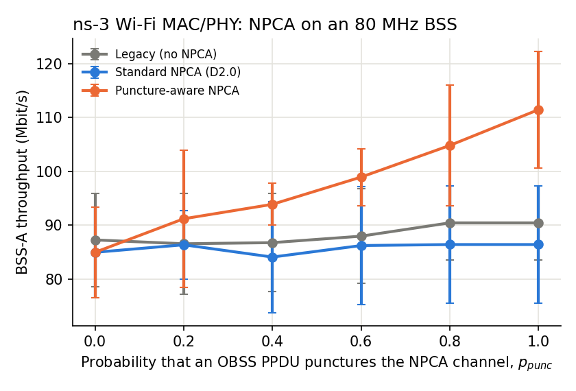
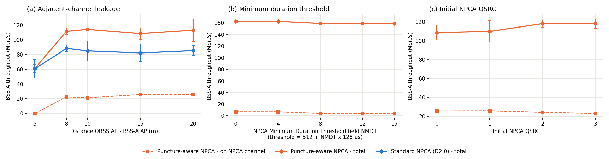

# Puncture-Aware NPCA for ns-3

An ns-3.49 patch that implements PPDU-based NPCA (IEEE P802.11bn D2.0, 37.18) in the ns-3 Wi-Fi MAC/PHY, with the puncture-aware extension from "Puncture-Aware Non-Primary Channel Access" (VTC 2027-Spring).

[](https://colab.research.google.com/github/MisterInsomniac/puncture-aware-npca-ns3/blob/main/Puncture_Aware_NPCA_ns3_Colab.ipynb)

## What the patch adds
- NPCA switching to the NPCA primary channel on inter-BSS PPDUs (BSS color, minimum duration threshold, intra-BSS NAV), with switch and switch-back delays
- NPCA-specific backoff state (Initial NPCA QSRC) and restore on switch back
- ICF/ICR exchange: BSRP NTB Trigger and Multi-STA BlockAck (STA), MU-RTS/CTS (AP)
- UHR Operation element (NPCA Primary Channel, Disabled Subchannel Bitmap)
- EHT non-OFDMA preamble puncturing and the puncture-aware NPCA test
- `src/npca` module: paper model, scenarios and examples; tests in `src/wifi/test/wifi-npca-test.cc`

## Usage
```bash
git clone https://github.com/MisterInsomniac/puncture-aware-npca-ns3.git
cd puncture-aware-npca-ns3
git clone -b ns-3.49 --depth 1 https://github.com/nsnam/ns-3-dev-git ns-3
cd ns-3
git apply ../puncture-aware-npca.patch
./ns3 configure -d optimized --enable-modules="npca;wifi" --enable-examples --enable-tests
./ns3 build
./ns3 run "npca-wifi-mac --scheme=pa --ppunc=1"
```
Or open the notebook in Colab and run the cells in order (the build takes about 30–40 minutes).

## Results
Full-stack ns-3 simulation:



Parameter sensitivity (distance / ACI, NMDT, Initial NPCA QSRC):



Paper reproduction figures are in `results/npca-results/`.

## License
GPL-2.0, the same license as ns-3.
